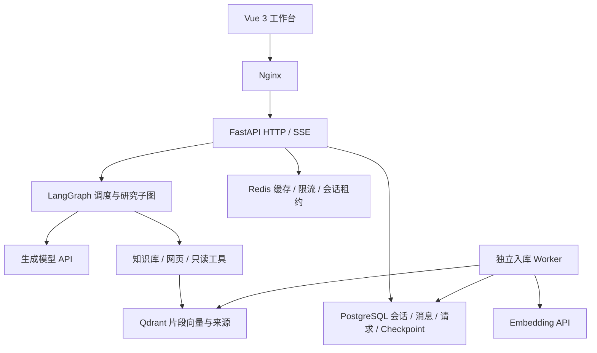

# 知研工作台 Knowledge Studio

面向技术资料调研与私有知识库问答的 Agentic RAG 应用。整合文档解析、知识库检索和联网搜索，支持多轮交互、流式回答与引用来源追溯，并将研究结果导出为可编辑 Word/PPT 报告。

## 功能

- 文档入库：上传后进入持久任务队列，后台完成解析、切分和向量化，支持查看进度、失败重试与重建索引。
- 多轮问答：保存会话与消息，结合历史上下文回答问题，支持取消、重试、会话搜索与管理。
- 研究工作流：选择直接回答、知识库研究、网页研究或混合研究。独立研究子图通过原生工具调用获取资料，再合并证据、写作和检查引用。
- 来源追溯：展示引用原文、网页链接与文档来源，区分搜索摘要、网页正文、论文摘要和计算结果。
- 报告导出：用户确认后将完成的回答导出为 Word/PPT，保留资料来源。导出是应用功能，不是模型任意写文件的工具。
- 可选工具：公开 GitHub 仓库与代码读取、arXiv 摘要查询、上传 CSV 的受限聚合计算，以及需额外凭据的技术文档、天气和出行接口。

## 架构



| 层 | 技术与职责 |
| --- | --- |
| 前端 | Vue 3、Vite、Nginx，展示增量回答、工具进度和引用详情 |
| API | FastAPI、Pydantic、SQLAlchemy，参数校验、异步接口和请求协调 |
| Agent | LangGraph、Function Calling，状态编排、独立研究子图、证据合并与有限修订 |
| 业务数据 | PostgreSQL，保存会话、消息、请求终态、入库任务和图快照 |
| 缓存与协调 | Redis，搜索/向量缓存、原子限流和跨进程会话租约锁 |
| 检索 | Qdrant、云端 Embedding，按模型指纹隔离索引 |
| 交付 | Docker Compose、Alembic、持久 Worker 队列 |

设计细节见 [架构说明](docs/architecture.md)。

## 快速启动

需要 Docker Desktop（或 Docker Engine）及 Docker Compose。默认使用云模型，不启动 Ollama，也不要求 GPU。

### 1. 准备配置

首次部署在项目根目录执行；已有 `.env` 时不要覆盖：

```powershell
Copy-Item .env.example .env
```

编辑本机 `.env`，至少填写：

| 配置 | 用途 |
| --- | --- |
| `POSTGRES_PASSWORD` | 自设数据库密码，替换样例占位值 |
| `POSTGRES_DSN`、`LANGGRAPH_POSTGRES_DSN` | 本机 Python 直连使用的连接串，密码与上项一致 |
| `LLM_API_KEY` | 默认生成模型的 API Key |
| `EMBEDDING_API_KEY` | 向量模型的 API Key |
| `BOCHA_API_KEY` | 使用默认博查搜索时填写，不需要联网研究可留空 |

Compose 会从数据库配置构造容器内连接串。已有数据库时，仅修改 `.env` 不会更新数据库角色密码，请参考 [配置说明](docs/configuration.md)。

### 2. 构建并启动

```powershell
docker compose config --quiet
docker compose up --build -d
docker compose ps -a
```

`config --quiet` 检查配置，不打印含密钥的展开结果。`migrate` 容器成功退出后，API 和 Worker 才启动。

### 3. 使用

- 工作台：`http://localhost:8080`
- API 文档：`http://localhost:8001/docs`
- 就绪检查：`http://localhost:8001/api/v1/health/ready`

上传文档并等待“已就绪”，然后提问。需要联网研究时启用网页搜索。就绪检查只验证数据库、Redis 和 Qdrant，不代表模型或搜索服务已经通过实际调用验证。

## 模型与工具配置

根目录的 [`.env.example`](.env.example) 是唯一面向使用者的配置样例，包含默认模型、向量、搜索和可选工具。真实 `.env` 不提交到仓库。

| 能力 | 默认/可选方案 | 状态边界 |
| --- | --- | --- |
| 生成模型 | 百炼 Qwen Plus/Flash | 有真实调用验收记录 |
| 向量模型 | 百炼 text-embedding-v4 | 有真实入库与检索验收记录 |
| 网页搜索 | 默认博查，可选 Tavily | 博查有真实调用记录，外部服务仍受网络、配额和结果质量影响 |
| 模型切换 | DeepSeek、MiniMax、智谱等适配 | 需要相应 Key 与供应商可用模型，不代表全部供应商已验证 |
| 本地模型 | Ollama profile | 保留配置入口，默认不启用，不承诺当前硬件性能 |
| 扩展工具 | 技术文档、天气、地点与路线 | 需额外配置，未取得真实认证验收的接口不标为已验证 |

完整变量和 Ollama 用法见 [配置说明](docs/configuration.md)，工具调用条件见 [工具能力](docs/tools.md)。

## 工程机制

- 工具执行使用参数 Schema、白名单与 `tool_call_id` 配对，工具失败与零结果分别记录。
- 回答限定证据上下文预算，引用编号做机械检查，模型检查与修订有明确次数上限。
- 请求幂等记录与 Redis 会话租约锁协调重复提交和同会话并发。
- 文件入库使用 PostgreSQL `SKIP LOCKED` 队列，支持 Worker 重启后的过期任务恢复。
- 向量集合由供应商、模型和维度生成指纹，切换模型不会混用旧向量空间。
- SSE 区分草稿、修订重置、完成和错误，不将连接关闭视为回答成功。

这些机制不能替代人工核对，也不构成未经测量的准确率或吞吐保证。

## 目录

```text
backend/
  app/                  API、Agent、工具、数据和后台任务
  migrations/           Alembic 业务表迁移
  tests/                单元与集成测试
    fixtures/           显式模拟配置，仅供测试
frontend/               Vue 工作台、前端测试和 Nginx 配置
docs/                   架构、配置、接口、工具和开发文档
scripts/                部署检查与功能验收入口
.env.example            统一配置样例，不包含真实密钥
docker-compose.yml      服务编排
pyproject.toml          Python 项目与依赖声明
uv.lock                 Python 依赖锁定
```

本机 `.env`、`data/`、`evaluation/`、虚拟环境和个人简历不随仓库提交。验收脚本会自行生成本地报告，仓库不预置个人运行数据。

## 开发与验证

```powershell
uv sync --frozen
uv run pytest -p no:cacheprovider
cd frontend
npm ci
npm test
npm run build
```

默认排除需基础设施的集成测试。测试模拟响应、工程协议与边界，不应当作真实模型回答质量指标。集成测试、无云密钥模式和可能产生调用费用的验收脚本见 [开发与验证](docs/development.md)。

## 范围与安全

当前是单个私有共享工作空间，不包含账号级多租户隔离或完整 RBAC。端口默认绑定本机，可配置 `APP_ACCESS_TOKEN` 保护接口。公网部署还需要 TLS、正式认证、权限隔离和备份策略。

网页读取不会绕过登录或付费墙，GitHub 工具不执行仓库代码，CSV 工具不接收任意 SQL。扫描版文档需先 OCR。引用检查通过不代表每条事实已经正确，重要结论应人工复核。

项目属于个人工程实践，开发过程中使用了 AI 辅助。对外发布前应核对参考材料、代码和字体资源的许可，不把未实现的能力写作已交付功能。

## 文档

- [架构说明](docs/architecture.md)
- [配置说明](docs/configuration.md)
- [工具能力与限制](docs/tools.md)
- [运行与排错](docs/runbook.md)
- [API 接口](docs/api.md)
- [开发与验证](docs/development.md)
- [搜索与报告导出](docs/search-and-office.md)
- [中英文提示词档案](docs/prompts/2026-10-13-tools-v1/)
